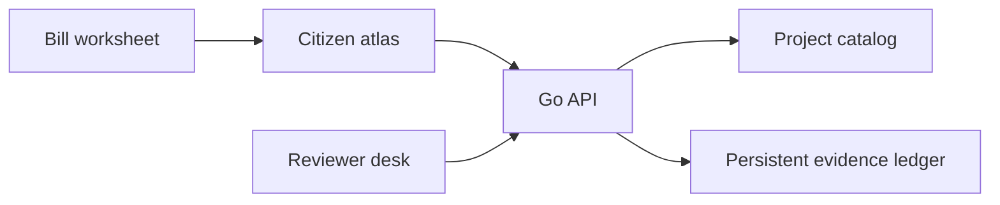

# Nirikshan · Public Works Atlas

<div align="center">
  
  <h2>Public Works Atlas for India</h2>
  <p>Follow public money from tender to evidence.</p>
</div>

[](https://github.com/atharvtamboli/nirikshan_ai/actions/workflows/pilot.yml)  

[Quick start](#run-on-windows-linux-or-macos) · [Data sources](DATA.md) · [Service guide](cmd/pilot/README.md)

Follow a Rajasthan bridge tender from the advertised price to the documents available for public inspection. The pilot covers five Udaipur works. Find a bridge in Hindi or English, inspect the official tender, and compare a bill line with a measurement-book entry.

| Explore | Investigate | Review |
| --- | --- | --- |
| Five sourced bridge tenders, search and shareable links | Compare bill quantities, measurements and contract rates | Submit news or records, review evidence and publish decisions |
| Hindi and English, mobile layout and offline catalog | Source links and explicit record availability | Persistent event history and receipt tracking |

## Architecture



## Run on Windows, Linux or macOS

With Go 1.24.1 or newer installed, open a terminal in this directory.

```sh
go run .
```

Open **http://localhost:8080**. The new service builds with the Go standard library. Public browsing works immediately. For a local review session on Windows, start the service with the following PowerShell commands. The second line copies a fresh private token to your clipboard for the reviewer page. Clear the clipboard after unlocking.

```powershell
$env:REVIEW_TOKEN = [guid]::NewGuid().ToString('N') + [guid]::NewGuid().ToString('N')
Set-Clipboard $env:REVIEW_TOKEN
go run .
```

## Try one complete workflow

For the interactive lifecycle demonstration, start the service in PowerShell:

```powershell
$env:NIRIKSHAN_DEMO = "1"
go run .
```

Open http://localhost:8080/lifecycle.html. The Aravalli bridge is fictional. The demonstration desks record sanctions, tenders, bids, awards, work orders, construction, delivery records, bills, certifications, payments, inspections and citizen reports. Updates persist locally and refresh across open tabs. Demo writes require an explicit local opt-in.

Citizen reports support optional photo uploads and approximate device location. The service strips image metadata, hashes the cleaned photo and flags matching images. A report can be acknowledged, resolved and reopened. The department desk is a local simulation. Structured bill entries support invoice references, quantities and rates, with arithmetic and duplicate-reference flags. Export a project evidence bundle with its photos and verify its included SHA-256 digests locally.

The project tracker supports searchable state, district and category fields, planned dates, illustrative route endpoints and contractor-reported physical progress. Awards reference recorded quotations. Contract work items and approved quantity increases can be linked to bills, which are then certified against their recorded rate and remaining quantity. News links may be attached for review. The financial signals are deterministic comparisons of recorded figures.

The local demo runs without paid services. Its workflow is fictional, and the public atlas continues to use separately sourced tender notices. Real department adoption requires verified accounts, project-linked official records and an agreed grievance delivery channel.

Evidence exports now include an Ed25519 signature produced using a persistent local installation key. Save the public signing fingerprint separately and paste it into the verifier when checking later bundles. Signature verification detects changes even if an editor recomputes the SHA-256 digest. Protect and back up the private key under the local data directory; the key identifies this installation and does not represent a government endorsement or an external blockchain timestamp.

The engineer desk records measured test results, sample references, units and minimum or maximum acceptance criteria against a contract work item. The dashboard compares these measurements to the entered criterion and shows both the source and result.

The [records request builder](web/records-request.html) uses the five sourced tender records to prepare editable Hindi or English requests for missing sanctions, work orders, bills, payments, inspections and progress records. It generates a downloadable draft locally.

1. Search for Boramcha. Open the official source beside its advertised amount. Inspect the missing award and payment fields.
2. Open the bill worksheet. For a hypothetical line, use 12.5 billed units, 10 measured units, a ₹40 contract rate and ₹510 printed subtotal. The differences are ₹10 against the billed calculation and ₹110 against the measured calculation. Check the underlying units, approved changes and source records before drawing conclusions.
3. In a local review session, submit an evidence link. Copy the receipt and confirm the entry awaits review. Open the reviewer desk, inspect the original, enter a reason, then accept or reject.
4. Reload the bridge. Approved evidence becomes public. Restart the service using the same data directory and check the record again.

## How evidence works

Every project has an official source and tender ID. The evidence workflow accepts bills, awards, payments, inspections, news and observations. News is attributable context. Published review checks compare structured entries with linked references. A flag invites inspection of the source. The pilot does not certify engineering quality or establish wrongdoing.

The five-project source audit and coverage decision are in [DATA.md](DATA.md). [Service operations](cmd/pilot/README.md) describes persistence, reviewer credentials and integrity limits. Root and cmd/pilot launch the same server. The original single-node blockchain prototype is preserved under legacy/ with its own module and README. Legacy routes remain available only by launching that prototype separately.

## Deploy

Use the repository's render.yaml Blueprint for one native Go service with a persistent disk. Select the branch containing this rebuild. Review the quoted service and disk charges in the hosting account before provisioning. Keep one writer instance. Retrieve the generated REVIEW_TOKEN through the hosting account and share it privately with the designated pilot reviewer. Use the hosted HTTPS address for public links.

After deployment, check /healthz, open a project on a second device and verify a reviewed record survives redeployment. Back up DATA_DIR off-host and rehearse restoring a copy with the same catalog. The static web/ directory can also be served separately for read-only exploration.

## Checks

```sh
go vet ./...
go test ./...
node --test tests/worksheet.test.cjs
```

On Windows with Edge and a recent Node.js installed, run the end-to-end browser check:

```powershell
go build -o bin/nirikshan.exe .
node tests/browser-smoke.cjs
```

Department use requires named reviewer accounts, operational monitoring, moderation ownership and independently backed-up records. This release uses a single-instance event store. Live news scraping, automatic document OCR and independent blockchain anchoring are outside this implementation.
