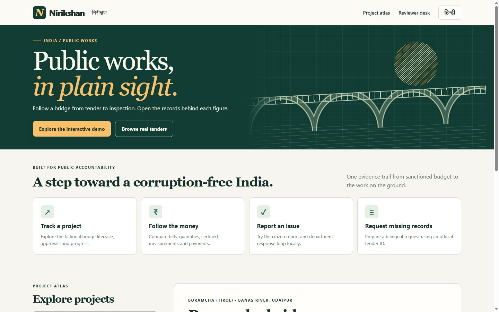
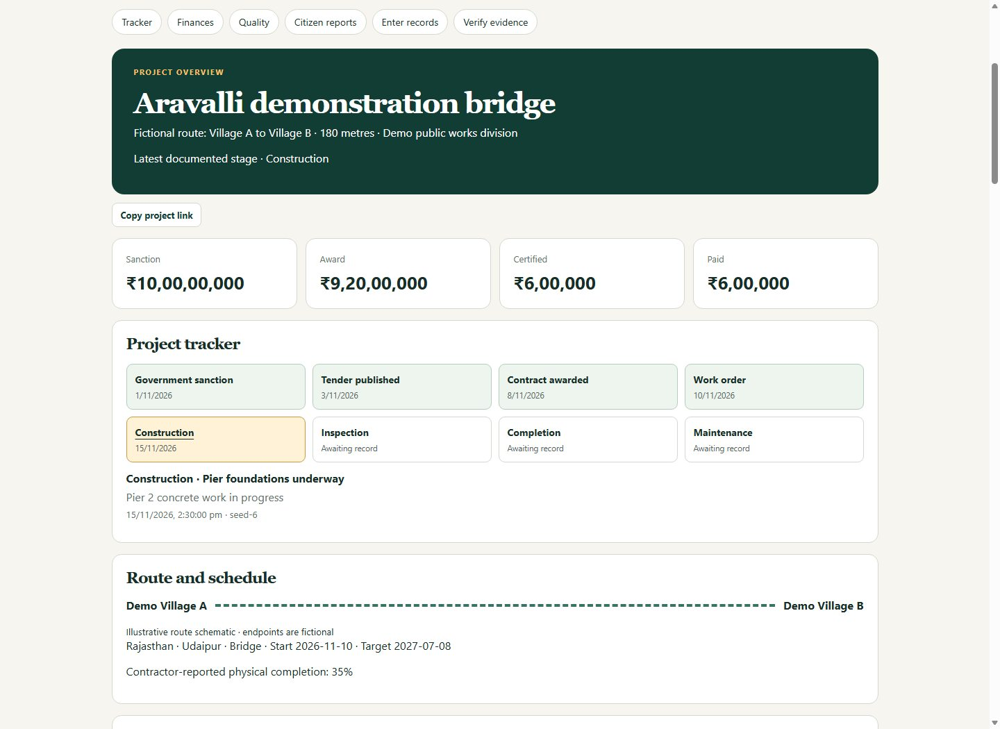
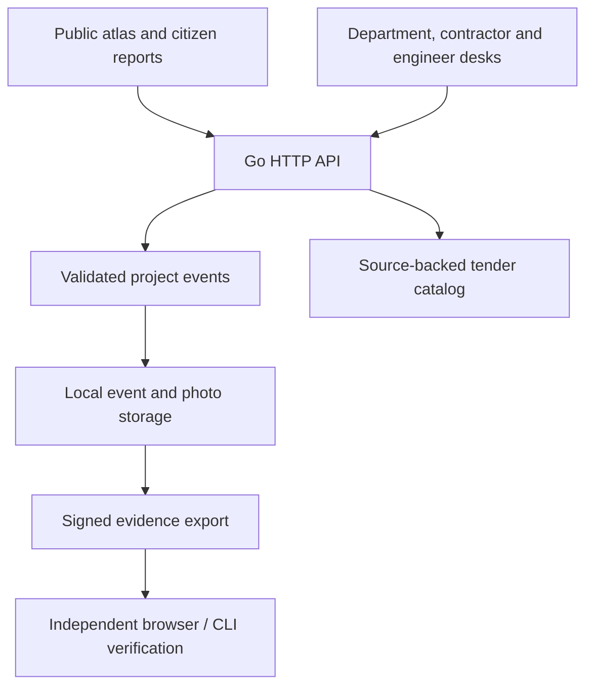

<div align="center">


# NIRIKSHAN AI · निरीक्षण

### A step toward a corruption-free India.

**Public infrastructure. Public money. Public evidence.**

[](https://github.com/atharvtamboli/nirikshan_ai/actions/workflows/pilot.yml)


[Run the demo](#quick-start) · [Watch the workflow](docs/DEMO.md) · [Data provenance](DATA.md) · [Architecture](#architecture)

</div>

---

## The idea

Imagine a resident standing at a bridge construction site. One project link lets them see the sanctioned amount, tender, contractor quotation, work order, material bills, certified measurements, payments, inspections and citizen reports. Every recorded claim has a place in the project timeline.

Nirikshan brings that workflow together in a working local civic-tech demonstration, designed for citizens, public works departments, engineers, contractors and independent reviewers.

## See it in action





## What is built

| Public accountability | Working capabilities |
| --- | --- |
| **Project atlas** | Five sourced Udaipur tenders, official tender links, Hindi and English, QR sharing and offline catalog |
| **Project lifecycle** | Sanction → tender → bid → award → work order → construction → inspection → completion → maintenance |
| **Follow the money** | Integer-paise budgets and payments, contract work items, delivery records, quantities, rates, invoices, variations and certified measurements |
| **Financial review** | Arithmetic discrepancies, repeated invoice references, quantities above approved scope, unverified billing and payment-versus-progress signals |
| **Quality evidence** | Sample references, measured results, acceptance criteria and contextual source links |
| **Citizen voice** | Photo and optional approximate device location, duplicate image digest, report receipts, acknowledgement, resolution and reopening |
| **Department workflows** | Interactive local government, contractor and engineer desks with validation, persistence and updates across tabs |
| **Independent verification** | Ed25519-signed project snapshots, photo digests, downloadable evidence and browser/CLI verification |
| **Request missing records** | Downloadable Hindi or English record-request drafts using actual tender IDs and issuing authorities |

## Quick start

Requirements: **Go 1.24.1+** and a modern browser. The demo uses the Go standard library and static assets with no external service keys.

```sh
git clone https://github.com/atharvtamboli/nirikshan_ai.git
cd nirikshan_ai
go run . -demo
```

Open **http://localhost:8080** or go directly to **http://localhost:8080/lifecycle.html**.

The local demo starts with a fictional bridge under construction and a fictional school that has reached maintenance. Create a new project or continue either scenario. All changes are stored under `data/`, which is excluded from version control. See [the demo walkthrough](docs/DEMO.md) for a complete presentation.

For a fresh named demonstration session on Windows, set a different data directory before starting the app.

```powershell
$env:DATA_DIR = "data/showcase"
go run . -demo
```

To run the source-backed public atlas without changing fictional records, use `go run .`. Enable the evidence reviewer on localhost with a private token.

```powershell
$env:REVIEW_TOKEN = [guid]::NewGuid().ToString('N') + [guid]::NewGuid().ToString('N')
Set-Clipboard $env:REVIEW_TOKEN
go run .
```

## Department workspace

The workspace starts with an empty project portfolio. The operator provisions named accounts and assigns non-department accounts to specific projects. A department officer records the sanction and tender, contractors submit quotations, the department selects an award, and the awarded contractor records work and bills. Engineers certify measurements and the department records payments against certified balances. Assigned citizens can file and follow their own reports.

Run `go run . -workspace` and open [the local workspace](http://localhost:8080/lifecycle.html?mode=workspace). See the [workspace runbook](docs/WORKSPACE.md) for account setup, tender import and audit exports.

## Architecture



| Directory | Responsibility |
| --- | --- |
| `web/` | Responsive public atlas, project tracker, reporting, review and verification |
| `internal/pilot/` | Project validation, persistent event stores, signatures and evidence moderation |
| `cmd/verify/` | Standalone evidence verification |
| `tests/` | Bill arithmetic and browser journey |
| `docs/` | Demo walkthrough and product screenshots |
| `legacy/` | Original hackathon blockchain prototype |

## Verify an evidence bundle

Export the selected fictional project from its tracker. The application signs the snapshot with a persistent Ed25519 installation key. Verify the exported file in the browser or independently at the terminal.

```sh
go run ./cmd/verify nirikshan-demo-evidence.json
go run ./cmd/verify -fingerprint YOUR_TRUSTED_FINGERPRINT nirikshan-demo-evidence.json
```

Save the signing fingerprint separately when establishing the signer identity. Changes to the signed payload or referenced images cause verification to fail. A local signature identifies the installation; it does not establish government endorsement.

## Evidence and data integrity

The public atlas uses five real Rajasthan tender notices. The fictional projects demonstrate operational workflows and retain their labels. Advertised estimates, awarded amounts, certified bills and payments are different records. A review signal invites examination of the underlying evidence, and engineering findings require qualified review. Optional approximate device location and photo digests support review without authenticating a physical observation.

[Data source inventory](DATA.md) · [Service operations](cmd/pilot/README.md)

## Test the project

```sh
go vet ./...
go test ./...
node --test tests/worksheet.test.cjs
```

On Windows with Edge and recent Node.js:

```powershell
go build -o bin/nirikshan.exe .
node tests/browser-smoke.cjs
```

The browser journey checks mobile/desktop layout, recorded quality measurements, citizen photo reports, department acknowledgement, signed exports, altered-bundle rejection and the bilingual records request.

## From demo to national pilot

The current release runs locally and supports the complete illustrated project workflow. A departmental pilot requires an operator to verify staff identity, provision accounts, supply official project records, and establish data-sharing, moderation and grievance routing. The workspace uses one local service and persistent files. Automated OCR, external news ingestion and independently anchored blockchain receipts remain future work.

The repository includes a hosting blueprint for a later deployment. Local use does not require hosting services.

---

<div align="center">

**Made for India. Built around evidence.**

</div>

[Pilot release readiness and deployment gates](docs/RELEASE_READINESS.md)
